A **process model** shows a business process as a sequence of activities, usually drawn as rectangles connected by arrows. The notation is simple enough that almost any stakeholder can grasp it immediately, which makes it a good way to present a candidate solution. Compare the [[Workflow Model]].

**Example:** Sally has a bentwood chair she no longer needs, and none of her friends want it. Freecycle is a platform for people to give away unwanted stuff. Read from the start circle to the end circle:

*Process model of a candidate Freecycle solution (slide 13)*

```mermaid
flowchart LR
    s(( )) --> a1["Sally joins Gotham Freecycle"]
    a1 --> a2["Sally takes photos of her chair"]
    a2 --> a3["The solution helps Sally to write her post"]
    a3 --> a4["Sally uploads her post"]
    a4 --> t{{"Time passes"}}
    t --> b1["Applicant responds to Sally's post"]
    b1 --> b2["Applicant & Sally arrange pickup"]
    b2 --> b3["Applicant picks up the chair and thanks Sally"]
    b3 --> e((( )))
```

