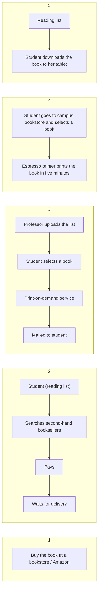

**Sacrificial (throw-away) candidate solutions** are several deliberately different [[Prototyping|prototypes]] of a solution, built to be discarded. One candidate isn't enough to open your mind to all the possibilities — generating many forces you (and stakeholders) to explore the problem space, and the comparison reveals the real requirements.

> [!quote] "If you want to have a good idea, have lots of ideas." — Linus Pauling

**Example:** college students must acquire the textbooks required for their courses. Five candidates:

*Five candidate solutions to the textbook problem (slide 8)*

